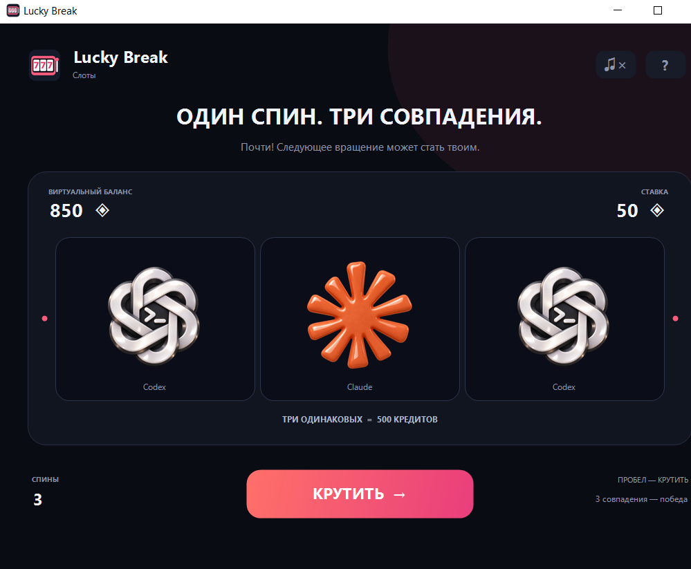

# Lucky Break

Маленькие слоты с четырьмя нейросетями: Codex, Claude, DeepSeek и Gemini.
Пробовала сделать плавную остановку барабанов и заодно собрала две версии —
для Windows и для браузера.

## Как запустить

### Windows

Скачайте [LuckyBreak.exe](https://github.com/Grifon-lab/lucky-break/raw/refs/heads/main/LuckyBreak.exe)
и запустите. Подходит для Windows 10/11 x64, установка не нужна.

### В браузере

Скачайте репозиторий через **Code → Download ZIP**, распакуйте и откройте
`web/index.html`. Сохраняйте папки `web` и `assets` рядом.

## Правила

Три одинаковых символа — выигрыш. Начальный баланс — 1 000 кредитов,
одно вращение стоит 50, выигрыш приносит 500.

Крутить можно кнопкой или пробелом. Кнопка с нотой включает звук,
знак вопроса открывает правила, Esc закрывает всплывающее окно.

## Что внутри

- `native/` — версия для Windows на C++ с Win32 и GDI+.
- `web/` — браузерная версия на обычных HTML, CSS и JavaScript.
- `assets/` — картинки для барабанов.
- `tests/` — проверки игровой логики.
- `build-windows.bat` — сборка EXE через MinGW-w64 x64.

Изображения для символов сгенерированы.
